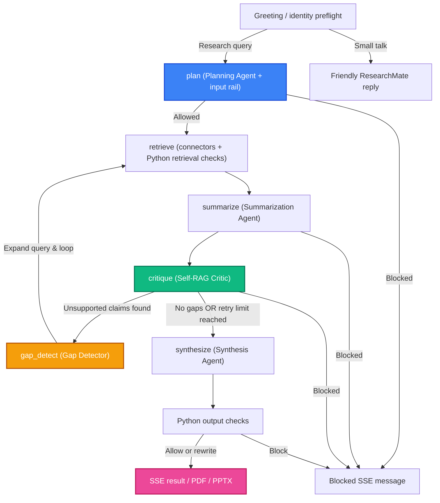

# 🔬 ResearchMate — Autonomous AI-Powered Literature Review Assistant

> **Self-RAG claim checking · NeMo input guardrails · Python retrieval and output checks · PDF & PPTX reports**

ResearchMate turns an academic research question into a literature-review draft using a **LangGraph** workflow and retrieved scholarly sources. Its **Self-RAG critic** checks draft claims against paper abstracts and can trigger another retrieval pass for unsupported claims. Guardrails are applied at three points: **NVIDIA NeMo Guardrails** runs the model-backed input self-check through Groq, while custom **Python rules** filter retrieved papers and check the assembled output before it is sent to the client.

---

## 📸 UI Showcase & Visual Experience

Every visual aspect of ResearchMate is crafted with sleek, high-fidelity **glassmorphic design systems**, deep space gradients, and premium micro-interactions.

### 1. Main Dashboard & Workspace Layout


### 2. Live Literature Review Canvas


### 3. Interactive Force-Directed Citation Network


---

## 🧠 System Architecture & Workflow

ResearchMate operates as a **coordinated agentic network** orchestrated via a LangGraph state machine. A greeting/identity preflight handles small talk before the graph starts. Research requests then pass through planning, retrieval, summarization, claim verification, optional retrieval for evidence gaps, synthesis, and a final output check.

### The Unified State Graph


---

## 🔬 Deep Dive: Self-RAG & Hallucination Defense

Standard LLMs suffer from "imagined citation" patterns. ResearchMate actively intercepts this via a multi-phase verification loop:

1. **Extraction**: The **Summarization Agent** drafts an initial literature review. The critic then calls `backend/utils/text_compressor.py :: extract_claims()` to split the draft into claim sentences; claim extraction is not performed inside the summarization agent.
2. **Analysis**: The **Self-RAG Critic** parses the draft sentence-by-sentence.
3. **Verification**: For every claim, the critic searches the harvested paper database using semantic keyword overlap algorithms.
4. **Auto-Binding**: If a claim matches the bibliography but lacks a tag, the critic **auto-binds** it and injects a `[cite:paper_id]` badge. If it is unsupported, it's flagged as a **citation gap**.
5. **Active Query Expansion**: The **Gap Detector** reformulates search queries for those exact gaps, sending them back to the retrieval harvesters to gather missing evidence.
6. **Softening**: The **Synthesis Agent** compiles the final paper. The Groq synthesis path may tone down or rephrase remaining unsupported claims; the local synthesis fallback does not perform that softening.

## Guardrails

| Rail | Where | What it checks |
| :--- | :--- | :--- |
| Input | Greeting/identity preflight before graph startup; NeMo `self check input` during planning, summarization, critique, and synthesis | Prompt-injection and unsafe-input checks, and whether a request is suitable for research; rejected requests return a `pipeline_blocked` response |
| Retrieval | Custom Python checks after each connector and after merge in `retrieval_agent` | Relevance, source trust, required metadata, duplicate records, and a rejection log |
| Output | Custom Python checks after synthesis and before the final SSE event; export endpoints reject a review when its latest output check blocked it | PII masking, unsupported/fabricated marker checks, and softening of absolute language |

NeMo Guardrails is used for the model-backed input self-check; retrieval and output checks are custom Python rules, not NeMo LLM flows. Output checks run on the assembled response, not on each streamed token.

The NeMo input check uses Groq's `openai/gpt-oss-20b` when `GROQ_API_KEY` is set. The same model ID is currently used by the Groq-backed planning, summarization, critique, and synthesis agents. Recognized greetings and identity questions, such as `hi` and `who are you?`, receive a friendly reply before the graph starts. Without a Groq key, the model-backed NeMo check is skipped and only the local deterministic input checks run. If the NeMo/Groq input check errors, the request is blocked. Groq provides inference, so this setup does not require an NVIDIA-hosted model key.

---

## 📂 Project Directory Structure

```
ResearchMate/
├── backend/
│   ├── main.py                    # FastAPI server (SSE streams, PDF/PPTX endpoints)
│   ├── requirements.txt           # Windows pure-python dependencies
│   ├── .env.example               # Clean environment variables template
│   ├── guardrails/
│   │   ├── rails.py               # NeMo/Groq input check, small-talk detection, output checks
│   │   ├── input_rails.py         # Input rail wrapper and blocked exception type
│   │   ├── retrieval_guard.py     # Python relevance, metadata, trust, and dedupe checks
│   │   ├── config.yml             # NeMo rail configuration
│   │   ├── prompts.yml            # Guardrail prompt templates
│   │   └── input/
│   │       ├── config.yml         # NeMo input self-check configuration
│   │       └── prompts.yml        # Input safety and scope prompt
│   ├── agents/
│   │   ├── planning_agent.py      # Breaks query into subtopics via Groq
│   │   ├── retrieval_agent.py     # Orchestrator (Scholar, arXiv, OpenAlex, Wiki, Tavily)
│   │   ├── summarization_agent.py # Narrative writing compiler
│   │   ├── self_rag_critic.py     # Sentence-level support verification & auto-binder
│   │   ├── gap_detector.py        # Unsupported claim query expander
│   │   └── synthesis_agent.py     # Final report compiler & bibliography cleaner
│   ├── graph/
│   │   └── workflow.py            # LangGraph State Graph workflow definitions
│   ├── utils/
│   │   ├── keyword_filter.py      # Retrieval relevance helper
│   │   ├── text_compressor.py     # Sentence/claim extraction helper
│   │   └── citation_db.py         # Citation metadata helper
│   ├── retrieval/
│   │   ├── semantic_scholar.py    # Semantic Scholar API connector
│   │   ├── arxiv_api.py           # arXiv API connector
│   │   ├── wikipedia_api.py       # Wikipedia concept searcher
│   │   ├── openAlex_api.py        # OpenAlex API search integration
│   │   └── tavily_search.py       # Tavily Web Search API client
│   ├── output/
│   │   ├── ppt_generator.py       # PPTX Slide Deck generator
│   │   └── pdf_generator.py       # Pure-python ReportLab academic PDF generator
│   ├── tests/                     # Input, retrieval, output, and rail contract tests
│   └── eval/                      # Golden queries, evaluation runner, and demo
├── frontend/
│   ├── app/                       # Next.js App Router (Layout & Pages)
│   ├── components/                # Glassmorphic React dashboard components
│   ├── .env.local.example         # Next.js API client setup template
│   └── tailwind.config.ts         # Sleek glassy design tokens
└── assets/                        # Screenshots & graphic documents
```

---

## 🛠️ Step-by-Step Installation & Quickstart

### 1. Backend Configuration (FastAPI)

Navigate into the backend folder, configure a virtual environment, and install dependencies:
```bash
# Move to backend folder
cd backend

# Create virtual environment
python -m venv venv

# Activate virtual environment
# On Windows:
venv\Scripts\activate
# On macOS/Linux:
source venv/bin/activate

# Install required python packages
pip install -r requirements.txt
```

#### Environment Variables (`backend/.env`)
Copy the template `.env.example` file to create your active environment file:
```bash
copy .env.example .env
```
Open the new `.env` file and populate your keys:
```ini
# Groq API key for openai/gpt-oss-20b (obtain from https://console.groq.com/)
GROQ_API_KEY=gsk_yourKeyHere...

# Web Search Key (obtain from https://tavily.com/)
# Set to 'change_this' or leave blank to skip general web search
TAVILY_API_KEY=tvly-yourKeyHere...
```
The backend currently uses the Groq model ID `openai/gpt-oss-20b` for its LLM-backed agents and NeMo input check. If Groq reports that a model is unavailable for your account, verify the model ID is enabled for your Groq account before starting the backend.

Run the backend server:
```bash
python main.py
```
*The FastAPI backend will start on **`http://localhost:8000`** with real-time file-watching reload.*

---

### 2. Frontend Configuration (Next.js)

Open a new terminal window, navigate into the frontend folder, and set up your client environment:
```bash
# Move to frontend folder
cd ../frontend

# Install node dependencies
npm install

# Run the development server
npm run dev
```
*The dashboard will boot and become instantly accessible at **`http://localhost:3000`**.*

---

## 📋 Scannable Commands Checklist

| Service | Action | Terminal Command | Directory |
| :--- | :--- | :--- | :--- |
| **Backend** | Create Venv | `python -m venv venv` | `/backend` |
| **Backend** | Activate Venv | `venv\Scripts\activate` | `/backend` |
| **Backend** | Install Packages | `pip install -r requirements.txt` | `/backend` |
| **Backend** | Run Server | `python main.py` | `/backend` |
| **Frontend** | Install Deps | `npm install` | `/frontend` |
| **Frontend** | Run Client | `npm run dev` | `/frontend` |
| **Frontend** | Check Types/Build| `npm run build` | `/frontend` |

---

## 📑 Core Export Operations
Once the literature review is generated, you can download premium assets directly from your workspace:
* **Academic PDF Report**: Styled with multi-level heading styles, elegant footers, page-budget layouts, and automated bibliography citation indexes.
* **PowerPoint Slide Deck**: Formatted with high-contrast presenter designs, automatic summary splits, and slide-level citing.

## Evaluation

The evaluation harness and generated comparison data are under `backend/eval/`:

- [backend/eval/results_after.csv](backend/eval/results_after.csv)
- [backend/eval/results_before.csv](backend/eval/results_before.csv)
- [backend/eval/demo_block.py](backend/eval/demo_block.py)

The interview demo can be run with `python backend/eval/demo_block.py`.
